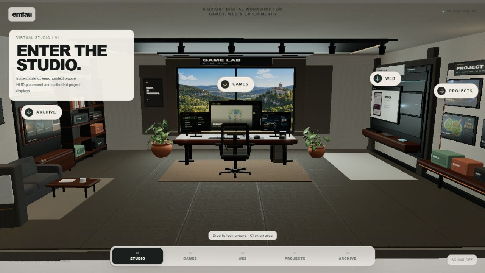
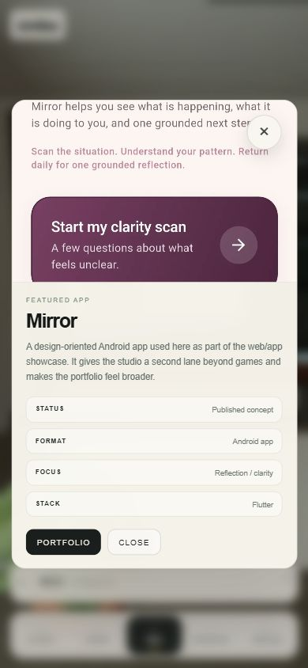

# basement – abgeschlossene begrenzte Web-Grundanalyse

Stand: **09.10.2026**. Live geprüft: [basement](https://emfau88.github.io/basement/), Desktopbreite 1281 und schmale Browseransicht 391 Pixel. Ergänzend wurden die aktiven Quellen unter `C:\Users\madde\Documents\basement` ausschließlich lesend untersucht. **Die Grundanalyse ist abgeschlossen; die Originalwebsite wurde nicht verändert und eine zentrale Homepage nicht ausgewählt.**

## Ergebnis

**basement ist ein eigenständiger räumlicher Showcase für eigene Games, Apps und Entwicklungsgeschichte.** Das tatsächlich geladene Studio wirkt wie ein begehbarer digitaler Arbeitsraum mit Monitoren, Produktbildern, unterschiedlichen Bereichen und passenden Kamerafahrten. Projektansichten sind nicht bloß Dekoration: Ein Mirror-Detaildialog ließ sich öffnen; die mobile Projektauswahl funktioniert ebenfalls, einschließlich MewTrack mit direktem Play-Store-Ziel.

**Als alleinige Website für den Verkauf von Homepages ist der aktuelle Auftritt noch nicht ausreichend.** Angebot, Geschäftskundennutzen, Websitebeispiele und Kontaktweg fehlen. Der Bereich „Web“ zeigt Apps. Mehrere Produkte führen erst zu Portfolio3, und manches Detail beschreibt vor allem seine Rolle im Showcase statt den Nutzen des eigentlichen Produkts. Für eine ergänzende Portfolio-/Erlebnisrolle ist das Konzept deutlich plausibler.

## Identität und Prüfstand

Repository [emfau88/basement](https://github.com/emfau88/basement). Lokaler Branch **`mobile/scene-first-ux`**, HEAD `60485a6107c3405d765d342a2506f1952eb9fc0c` vom 30.09.2026; nur `docs/preview/` unversioniert. Der Branch ist nicht `main`; **Gleichheit mit dem Live-Bundle ist nicht bewiesen**. Projektmetadaten nennen Version `11.0.0`, aktiver Einstieg ist `index.html` → `src/main.ts`.

[Quellenpruefung.md](Quellenpruefung.md) dokumentiert Route-/Statepfade, Katalog und konkrete Zeilennachweise. Keine Originaldateien, Abhängigkeiten, Builds oder Veröffentlichung verändert.

## Tatsächlich beobachtet

| Prüfung | Beobachtung | Aussagegrenze |
|---|---|---|
| Desktopstart | Loader, danach wirklicher virtueller Raum mit Game-/Appmonitoren und Bereichsmarkern. | Keine gemessene Ladezeit/FPS, keine physische Geräteleistung geprüft. |
| Desktop-Webbereich | Navigation „02 Web“ fährt zur Appwand mit Mirror, ZeroHero, between, ChargeGeist und MewTrack. | Die Bezeichnung Web entspricht hier keinem Katalog von Kundenwebsites. |
| Mirror-Detail | Klick auf große Preview öffnet HTML-Dialog. Beschreibung nennt die Showcase-Rolle; Metadatum „Published concept“. Einziger externer CTA: Portfolio3. | Keine erneute Mirror-Appbedienung oder vollständige Releaseprüfung. |
| Schmale Projektauswahl | Unteres DOM-Sheet lässt sich auf- und zuklappen; Produktauswahl ist möglich. MewTrack auswählen und Details öffnen zeigt passenden Text und direkten Google-Play-Link. | Nicht alle Produkte und Kamerawege im mobilen Layout getestet. |
| Schmaler Dialog | Der gespeicherte **Mirror-Dialog** passt in die schmale Browseransicht; Text, Metadaten und Buttons bleiben erreichbar. | Das Bild zeigt Mirror, nicht den getrennt geprüften MewTrack-Dialog. |
| Navigation/Adressen | Bei den geprüften Bereichs-/Detailwechseln änderte sich die URL nicht. Ein Contact-Bereich beziehungsweise Anfrageweg wurde nicht gefunden. | Kein umfassender Back-/Reload- oder Ausfalltest. |

## Stärken

- **Ein eigenständiges Erlebnis ist tatsächlich umgesetzt.** Raumkomposition, Pflanzen, Möbel, Produktmonitore und Kamerawechsel bilden einen zusammenhängenden Auftritt. Es handelt sich im geprüften Browser um eine funktionierende Szene, nicht nur um eine Konzeptbeschreibung.
- **Die 3D-Ansicht hat echte Produktanschlüsse.** Desktopdetails öffnen sich; mobile DOM-Auswahl und Dialoge funktionieren im geprüften Weg. MewTrack besitzt einen korrekten direkten Store-Link.
- **Games, Apps und Archive werden kuratiert gezeigt.** Quellen weisen 19 unterschiedliche Projekte nach. Neun Games, fünf Web-/Appplätze, vier Featured-Karten und vier Archiveplätze sind 22 Platzierungen mit Überschneidungen, keine 22 Produkte.
- **Mobile Hilfen und HTML-Details sind bereits vorhanden.** Responsive Sheets, fokussierte Dialoge, Bildfehlerbehandlung und reduzierte Bewegung sind in aktiven Quellen vorgesehen. Der beobachtete schmale Mirror-Dialog ist brauchbar, ohne daraus vollständige Barrierefreiheit abzuleiten.

## Fünf wesentliche Befunde

### 1. Ein Weg zu einer Websiteanfrage fehlt

**Laufzeitbeobachtung und Codeabgleich · hohe Priorität.** Der Einstieg lädt zum Erkunden des Studios ein; Navigation und aktive Detailtexte bieten keinen Anbieter-/Kontaktweg. Im gelesenen aktiven HTML-/TypeScript-Bestand wurde kein Mail-/Telefon-/Formularzugang gefunden. Ein möglicher Kunde muss damit außerhalb dieses Auftritts herausfinden, wie er ein Vorhaben besprechen kann.

**Kleine Maßnahme:** Einen klaren Kontakt-/Anfragezugang und einen kurzen verständlichen Leistungs-/Überblicksteil ergänzen, sofern diese Website eine zentrale Anbieterrolle erhalten soll. Kein gemessener Befund über verlorene Aufträge.

### 2. Bereichsnamen und Texte erklären den Produkt-/Kundennutzen noch ungleichmäßig

**Laufzeit- und Quellenbefund plus Bewertung · mittlere Priorität.** „Web“ und „Selected web work“ führen zu Android-Apps. Das Hero beschreibt „Inspectable screens, context-aware HUD placement and calibrated project displays“ – technische Darstellungsdetails statt eines konkreten Nutzens für Websitekunden. Mirrors geöffneter Text erklärt unter anderem, dass die App den Showcase breiter macht. Das ist für die Entstehung des Raums nachvollziehbar, hilft einem Produktinteressenten aber weniger bei „Was macht diese App für mich?“.

**Kleine Maßnahme:** Web/App-Zuordnung eindeutig benennen und die wenigen wichtigsten Produkttexte zuerst am tatsächlichen Nutzen ausrichten. Entwicklungs-/Showcase-Hintergrund kann als Zusatz erhalten bleiben. Kein Grund, den Raum vollständig neu zu gestalten.

### 3. Einige echte Produkte führen zunächst zu einem zweiten Portfolio

**Laufzeitbeobachtung und Codeabgleich · mittlere Priorität.** Mirrors Dialog verlinkt nur auf Portfolio3; Code zeigt solche Umwege auch bei ZeroHero, between, Core Arena, Pocket Pier und Kessel-Krawall. Andere Datensätze, darunter MewTrack, besitzen bereits direkte Play-/Store-Ziele. Daher ist die Problemstellung eine ungleichmäßig gepflegte Linkliste, keine grundsätzlich fehlende Detailfunktion.

**Kleine Maßnahme:** Direkte vorhandene Spiel-/Storeziele ergänzen und CTA nach Ziel benennen. Den Portfolio-Link als zusätzliche Referenz erhalten, wenn sinnvoll. Die Zielprodukte wurden dadurch nicht vollständig neu geprüft.

### 4. Einzelne Produktansichten sind noch nicht direkt teilbar

**Laufzeitbeobachtung und Codebefund · mittlere Priorität.** Bei den geprüften Bereichs- und Detailwechseln bleibt die URL unverändert. Quellen speichern Auswahl und Kamerazustand intern und lesen/schreiben keine Projekt-Hashroute. Wer konkret MewTrack oder Mirror zeigen möchte, kann aktuell nicht einfach den geöffneten Detailzustand als eindeutigen Projektlink weitergeben.

**Kleine Maßnahme:** Wenige stabile Projekthashlinks ergänzen, falls gezieltes Teilen gewünscht ist. Vollständiges Browser-Zurück-/Reload-Verhalten wurde nicht getestet; kein zusätzlicher beobachteter Historyfehler wird behauptet.

### 5. Der Start-Fallback ohne WebGL liefert keinen vollständigen Katalog

**Quellcodebefund · mittlere Priorität.** Mobile Auswahl und HTML-Dialoge sind vorhanden. Scheitert die Studioinitialisierung, erzeugt der aktive Fallback jedoch nur „The studio needs WebGL“ und einen Browser-/Hardwarebeschleunigungshinweis. Ein Projektdatenindex oder Anfrageweg wird in diesem Pfad nicht aufgebaut. Ein späterer Contextverlust hat einen separaten Wiederherstellungshinweis.

**Kleine Maßnahme:** Einen einfachen DOM-Katalog mit Kontakt als Alternative anbieten, besonders falls das Studio die einzige zentrale Anlaufstelle wird. Kein tatsächlicher GPU-Ausfall wurde provoziert; keine gemessene Aussage, welche Besucher betroffen wären.

## Drei begrenzte nächste Maßnahmen

1. **Rolle und Inhalte verständlich machen.** Apps eindeutig benennen; Hero und wichtige Detailtexte auf Anbieter-/Produktnutzen ausrichten. Echten Kontaktzugang ergänzen, falls die Seite zentral verwendet werden soll.
2. **Vorhandene Produktziele und Teilen vereinheitlichen.** Direkte Spiele-/Storelinks nachtragen und stabile Projekt-Deep-Links vorsehen; mit wenigen repräsentativen Produkten prüfen.
3. **Eine schlichte Alternative ergänzen.** DOM-Projektindex mit Kontakt für schnellen Zugang und WebGL-Ausfall bereitstellen; schmale Ansichten, Tastatur und Fallback gezielt prüfen.

Das sind vorgeschlagene Schritte, keine bereits umgesetzten Fehlerbehebungen oder Veröffentlichung.

## Eignung für die spätere Homepageentscheidung

| Mögliche Rolle | Einschätzung aus dieser Grundanalyse |
|---|---|
| Kreativer eigener Produkt-/Entwicklungsshowcase | **Plausibel und eigenständig**, mit tatsächlich funktionierender Raum-/Detailbedienung. |
| Alleiniger Verkaufsauftritt für Homepages | **Derzeit nicht ausreichend**: Angebot, Geschäftskundennutzen, Webbeispiele und Anfrage fehlen. |
| Ergänzender Erlebnisbereich einer klareren Homepage | **Gut denkbar**; ein Direktzugang zu Produktinformationen kann die räumliche Darstellung ergänzen. |

Diese Einordnung trifft keine endgültige Auswahl zwischen den sieben Kandidaten und verspricht keinen Besucher- oder Umsatzgewinn.

## Bilder und Herkunft

Die Bilder stammen aus der **heutigen veröffentlichten Website im Browser**. Das mobile Detailbild zeigt **Mirror**, dessen Portfolio-CTA und Beschreibung. Die MewTrack-Detailbeobachtung ist separat protokolliert; dieses Mirror-Bild ist kein MewTrack-Nachweis. Schmale Browseransicht statt physischem Handy.

## Was offen bleibt

Kein vollständiges Prüfen aller 19 Produkte oder aller Inspektions-/Kamerawege. Keine physische Handyprüfung, vollständige Tastatur-/Screenreaderprüfung, künstliche GPU-/WebGL-Ausfälle oder Leistungsmessung. Lokaler Branch und Livebundle nicht als identisch bewiesen. Keine neue native Appprüfung und kein Gameplaycheck der vorgestellten Games. Kein vollständiger SEO-, Rechts- oder Sicherheitsaudit; keine Besucher-, Anfrage- oder Conversionzahlen vorhanden. Die Originale und Live-Seite bleiben unverändert.
