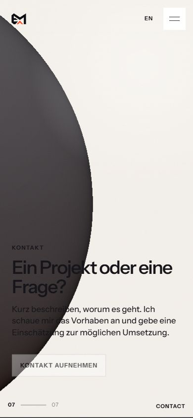

# blueyard – abgeschlossene begrenzte Web-Grundanalyse

Stand: **09.10.2026**. Live geprüft: [blueyard](https://emfau88.github.io/blueyard/), deutsche Startseite und Web-Unterseite, Desktopbreite 1281 und schmale Browseransicht 391 Pixel. Ergänzend wurde der lokale Arbeitsbaum unter `C:\Users\madde\Documents\bluebyte` ausschließlich lesend untersucht. **Die Grundanalyse ist abgeschlossen; Umsetzung, vollständige Geräteprüfung und die Auswahl der zentralen Homepage bleiben offen.**

## Ergebnis

**blueyard ist ein plausibler Entwurf für einen gemeinsamen emfau-Hub mit Web / Games / Labs.** Die Gestaltung hat eine eigene Identität: ruhige große Typografie, großzügige Flächen und eine farbige Partikelkugel. Auf Desktop lässt sich die Hauptbotschaft „Websites, Spiele und digitale Werkzeuge“ rasch verstehen. Das Menü erlaubt direkte Sprünge statt ausschließlich langem Scrollen.

**Der geprüfte Live-Stand ist noch kein vollständiger Verkaufs- oder Produktauftritt.** Der Kontaktweg ist nicht ausführbar; „Web-Projekte ansehen“ führt tatsächlich zur Vorbereitungsvorschau. In der schmalen Kontaktansicht liegt eine dunkle Kugelfläche über schwarzem Text und erschwert das Lesen. Diese drei konkreten Punkte sind wichtiger als eine pauschale Neugestaltung.

## Identität und Prüfstand

Repository [emfau88/blueyard](https://github.com/emfau88/blueyard); lokaler Branch `main`, HEAD `fe70c409a3e28c6b7cf5b42e4e3844804fe07521` vom 01.10.2026. Der Arbeitsbaum besitzt 13 modifizierte und fünf unversionierte Status-Einträge, darunter aktive Szenen-, Partikel- und Layoutquellen. **Der aktuelle lokale Inhalt und der ausgelieferte Live-Stand sind nicht als identisch nachgewiesen.**

Die Quellenprüfung mit konkreten Zeilennachweisen liegt in [Quellenpruefung.md](Quellenpruefung.md). Alte README-/QA-Aussagen sind keine neu bestandenen Tests. Keine Originaldateien, Abhängigkeiten oder Veröffentlichung verändert.

## Tatsächlich beobachtet

| Prüfung | Beobachtung | Aussagegrenze |
|---|---|---|
| Desktopstart | Kurzer geordneter Loader, danach große Hauptbotschaft und farbige Partikelkugel. | Keine gemessene Ladezeit, FPS oder Benchmark. |
| Menü | Öffnet sieben Stationen: Intro, Haltung, Bereiche, Web, Games, Labs und Kontakt. Der Web-Sprung funktioniert und setzt `#web`. | Nicht alle Stationen und Animationen vollständig geprüft. |
| Web-CTA | „Web-Projekte ansehen“ öffnet die echte `/web/`-Unterseite. Diese zeigt „wird gerade vorbereitet“, keine Projektbeispiele. | Games-/Labs-Unterseiten und EN-Routen ergänzend aus Quellen geprüft, nicht alle live durchgeklickt. |
| Schmale Kontaktansicht | Menü-Kontaktsprung funktioniert und setzt `#contact`. „Kontakt aufnehmen“ besitzt keinen ausführbaren Kontaktweg. | Kein echtes Formular abgesendet und niemand angeschrieben. |
| Schmale Lesbarkeit | Die dunkle Kugel nimmt den linken Teil der Ansicht ein; schwarze Überschrift und Teile des Fließtexts sind darauf deutlich schlechter lesbar. | Browserbreite 391 Pixel, kein physischer Handyscreen und kein vollständiger Konformitätstest. |

## Stärken

- **Eine erkennbare Marke und klare Hauptbotschaft.** Der Einstieg vermittelt sofort drei Arbeitsfelder, statt zunächst nur ein abstraktes Motto zu zeigen. Große Typografie und zurückhaltende Bedienelemente geben der Animation einen Rahmen.
- **Der gemeinsame Hub ist strukturell bereits angelegt.** Web, Games und Labs sind getrennt benannt; das Menü funktioniert im geprüften Desktop-/Mobilweg. Im Quelltext wird die Web-Zielgruppe konkret als Vereine, kleinere Unternehmen und Selbstständige beschrieben.
- **Technische Alternativen sind bedacht.** Quellen zeigen Tastatursteuerung, reduzierte Bewegung, semantische Menüpunkte und einen Canvas-Fallback bei Fehlern. Das ist eine gute Basis, ohne daraus vollständig geprüfte Barrierefreiheit abzuleiten.

## Vier wesentliche Befunde

### 1. Kontakt sieht wie eine Aktion aus, führt aber noch nicht zu einer Anfrage

**Laufzeitbeobachtung und Codeabgleich · hohe Priorität.** Die Kontaktstation ist erreichbar, „Kontakt aufnehmen“ bleibt jedoch deaktivierter Text. Der lokale Code rendert hier einen `span` mit `aria-disabled`. Ein zentraler Anbieterauftritt muss die Anfrage tatsächlich ermöglichen. Die aktuelle deutsche Formulierung „Kurz beschreiben, worum es geht“ setzt einen Weg voraus, der in der geprüften Ansicht fehlt.

**Kleine Maßnahme:** Einen echten Mail-/Anfragelink anschließen und Vorschauzustand beziehungsweise Kontaktbereitschaft eindeutig benennen. Kein Rückschluss auf eine gemessene Zahl verlorener Kunden.

### 2. Die angekündigten Projekte fehlen noch am Ziel

**Laufzeitbeobachtung und Codeabgleich · hohe Priorität.** „Web-Projekte ansehen“ führt zu einer funktionierenden Route, aber nur zu Vorbereitungstext. In den aktiven lokalen Quellen sind auch Games und Labs Varianten derselben Vorschauseite. Ein Websitekunde kann daher noch keine passende Referenz prüfen; ein Game-/Toolinteressierter bekommt an diesen Zielen ebenfalls noch keinen Katalog.

**Kleine Maßnahme:** Zwei bis drei passende Webbeispiele und wenige echte Produktziele anschließen. Allgemeine Leistungsdaten im Code zählen erst als Inhalt, wenn der aktive Seitenpfad sie ausgibt.

### 3. Die schmale Kontaktansicht hat ein konkretes Lesbarkeitsproblem

**Visuelle Laufzeitbeobachtung · hohe Priorität.** Im gespeicherten 391-Pixel-Bild treffen dunkle Kugelfläche und schwarzer Text aufeinander. Links verlieren „Ein Projekt oder eine Frage?“ und Teile der Erläuterung deutlich an Lesbarkeit. Das Problem liegt im Zusammenspiel von Szene und Textebene; die grundsätzliche Markenoptik muss deshalb nicht verworfen werden.

**Kleine Maßnahme:** Szene auf kleinen Breiten aus der Textfläche verschieben, abdunkelungsfreie Textzone oder ein zurückhaltendes Textpanel verwenden. Kontakt und alle übrigen Stationen danach in schmalen Ansichten und mit vergrößerter Schrift prüfen.

### 4. Der Szenenweg braucht eine klare Rolle

**Bewertung auf beobachteter Bedienung und Quellenbasis · mittlere Priorität.** Der Einstieg funktioniert als kreative Vorstellung, und das Menü verhindert eine reine Scrollpflicht. Trotzdem führt der Bereichsordner erst in eine Startseitenstation und deren CTA anschließend auf die Unterseite. Für jemanden mit konkretem Websitebedarf ist der schnellste Weg zu Angebot, Belegen und Kontakt wichtiger als das vollständige Durchlaufen des Szenenkonzepts.

**Kleine Maßnahme:** Bei Weiterverwendung einen jederzeit auffindbaren Direktweg zu Webbeispielen und Anfrage vorsehen. Ob Animation tatsächlich Besucher verliert, wurde nicht gemessen. Kein belegtes Argument, Games/Apps grundsätzlich aus einer gemeinsamen Homepage zu entfernen.

## Drei begrenzte nächste Maßnahmen

1. **Kontakt und konkrete Ziele vervollständigen.** Erst echte Anfrageaktion und wenige repräsentative Beispiele/Produkte verknüpfen; vorgeschlagene Arbeit, noch nicht umgesetzt.
2. **Mobile Textebenen sauber halten.** Die beobachtete Kugel-/Textüberschneidung beheben und alle Stationen bei schmaler Breite sowie großer Schrift nachprüfen.
3. **Hubrolle im Siebenervergleich festlegen.** Wenn blueyard die gemeinsame Startseite werden soll, Webverkauf und eigene Produkte direkt erreichbar machen; die endgültige Wahl erst nach dem Gesamtvergleich treffen.

## Eignung für die spätere Homepageentscheidung

| Mögliche Rolle | Einschätzung aus dieser Grundanalyse |
|---|---|
| Gemeinsamer Hub für Web, Games und Labs | **Plausibler Kandidat**, weil die Bereiche bereits klar angelegt sind. Wesentliche Inhalte und Kontakt fehlen noch. |
| Alleiniger Websiteverkaufsauftritt | **Derzeit nicht ausreichend**: keine ausführbare Anfrage und am geprüften Webziel keine Referenzen. |
| Kreativer ergänzender Showcase | **Gut denkbar**, wenn Inhalte und schmale Lesbarkeit vervollständigt werden. |

Das ist keine bereits gefällte Landingpage-Entscheidung und keine Vorhersage von Anfragen, Umsatz oder Nutzerzuwachs.

## Bilder und Herkunft

Die zwei gespeicherten Bilder stammen aus der **heutigen veröffentlichten Website im Browser**, nicht aus einem lokalen Produktbuild oder einem physischen Android-Gerät. Sie dokumentieren ausgewählte Zustände; sie beweisen keine vollständige Prüfung sämtlicher Szenen.

## Was offen bleibt

Die englische Fassung wurde nicht vollständig bedient. Kein physisches Handy, keine vollständige Tastatur-/Screenreaderprüfung, keine künstlich ausgelösten WebGL-/Netzwerkausfälle, keine Browservergleichs- oder Performancebenchmarks. Kein vollständiger SEO-, Rechts- oder Sicherheitsaudit. Es lagen keine Besucher-, Anfrage- oder Conversionzahlen vor. Die Qualität verlinkter Apps und Games wird durch diesen Websitecheck nicht neu bewertet.
