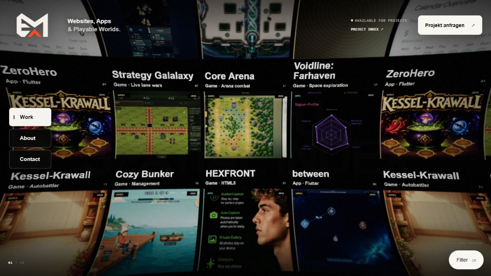
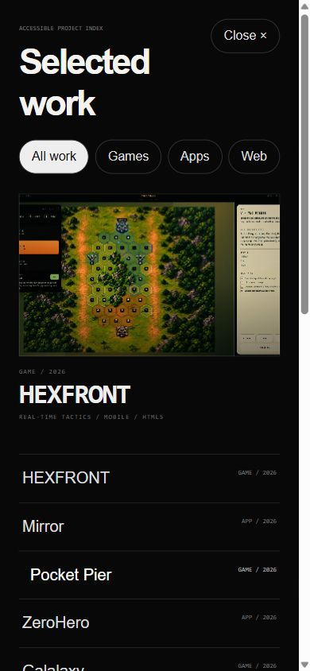

# phantom – abgeschlossene begrenzte Web-Grundanalyse

Stand: **09.10.2026**. Live geprüft: [phantom](https://emfau88.github.io/phantom/), Desktopbreite 1281 und schmale Browseransicht 391 Pixel. Ergänzend aktive Quellen unter `C:\Users\madde\Documents\phantom`, ausschließlich lesend. **Die Grundanalyse ist abgeschlossen; Änderungen und die endgültige Auswahl der zentralen Homepage wurden nicht vorgenommen.**

## Ergebnis

**phantom ist ein inhaltlich ausgearbeitetes persönliches Produktportfolio mit einer auffälligen räumlichen Projektwand.** Es zeigt echte eigene Games und Apps, besitzt Filter, einen gut lesbaren alternativen Projektindex und detaillierte Produktseiten. ZeroHero ließ sich tatsächlich aus dem Index öffnen; dessen Detailroute und Google-Play-Ziel waren korrekt angeschlossen.

**Für den Verkauf von Websites ist der derzeitige Auftritt noch nicht vollständig.** Der prominente Anfragebutton führt zu einem Kontaktblatt ohne tatsächliche Kontaktmöglichkeit. Im Katalog steht nur eine Website, das eigene Portfolio3. Die aufwendige Wand eignet sich gut zum Entdecken, vermittelt jedoch weniger unmittelbar ein konkretes Angebot für Geschäftskunden. Der mobile Projektindex ist deshalb ein wesentlicher vorhandener Zugang und sollte leicht auffindbar bleiben.

## Identität und Prüfstand

Repository [emfau88/phantom](https://github.com/emfau88/phantom); lokaler Branch `main`, HEAD `b1571d37df44a0b8cb7d7cd2a8c9c3ba574f7f9e` vom 02.10.2026, sauberer Arbeitsbaum. Der Codebestand und das ausgelieferte Live-Bundle wurden nicht per Binary-/Bundlevergleich als identisch nachgewiesen.

Aktiver Einstieg: `index.html` → React-/Three.js-Anwendung. Historisches `index2.html` und `legacy/v16-single-file.html` sind davon getrennt. [Quellenpruefung.md](Quellenpruefung.md) hält aktive Datenpfade und Zeilennachweise fest. Kein Originalcode, Build oder Deployment verändert.

## Tatsächlich beobachtet

| Prüfung | Beobachtung | Aussagegrenze |
|---|---|---|
| Desktopstart | Schwarze räumlich gebogene Wand mit zahlreichen Games-/Appansichten, eigenem Logo und festem Header. | Keine vollständige Drag-, Picking- oder Performanceprüfung. |
| Projektindex | „PROJECT INDEX“ öffnet eine semantische Liste mit 20 Projekten. | Nicht alle 20 Detailseiten geprüft. |
| ZeroHero | Auswahl aus dem Index öffnet Detailansicht und `#project/zerohero`; Google-Play-Link zeigt auf `com.energycrafted.zerohero`. | Zieladresse geprüft; dadurch kein neuer App- oder Android-Test. |
| Projektanfrage | „Projekt anfragen“ öffnet Contact-Sheet. Dieser nennt wörtlich noch anzuschließende endgültige Kontaktdaten und Anfragelinks; keine ausführbare Anfrage. | Keine Nachricht versandt. |
| Schmale Ansicht | Die Wand ist dicht und weniger leicht als vollständiger Katalog zu überblicken. Der Projektzähler/Browse-Zugang öffnet dagegen einen lesbaren Index. | Kein Nachweis, wie häufig echte Besucher diesen Zugang finden. |
| Webfilter | Reduziert korrekt auf ein Projekt, Portfolio3. | Damit wird kein Bestand an Kundenwebsites gezeigt. |

## Stärken

- **Eigenständiges, wiedererkennbares Portfolio.** Die gebogene schwarze Wand und echten Produktbilder vermitteln unmittelbar, dass hier eine größere Sammlung eigener digitaler Produkte steht. Die visuelle Eigenständigkeit ist kein Ersatz für Inhalte, hier sind aber tatsächlich Inhalte vorhanden.
- **Projektindex, Filter und Details tragen die Navigation.** Der geprüfte Index ist lesbar; Kategorien funktionieren, ZeroHero ist direkt erreichbar und als Detailroute teilbar. So kann man die Arbeit gezielt ansehen, ohne jede Wandkachel zu treffen.
- **Eine redaktionelle Grundlage ist vorhanden.** Die Quellen enthalten 20 Projektbeschreibungen, Case Studies, Medien und Produkt-/Repositoryziele. Für ein persönliches Produktportfolio ist das eine gute Basis, ohne die Qualität aller darin vorgestellten Produkte als erneut geprüft auszugeben.
- **Fallbacks und reduzierte Bewegung sind vorgesehen.** Code zeigt WebGL-Prüfung, DOM-Fallback und Bewegungspräferenz. Diese Pfade wurden in dieser Grundanalyse nicht durch künstlichen Ausfall praktisch getestet.

## Vier wesentliche Befunde

### 1. Der prominente Anfrageweg endet vor der eigentlichen Anfrage

**Laufzeitbeobachtung und Codeabgleich · hohe Priorität.** Ein Button „Projekt anfragen“ suggeriert einen vollständigen Kontaktweg. Das geöffnete Blatt enthält jedoch nur allgemeine Verfügbarkeit und den Hinweis, endgültige Kontaktdaten und Anfragelinks vor Release anzuschließen. Keine Adresse oder Formularaktion steht dort bereit.

**Kleine Maßnahme:** Echte Mail-/Anfrageaktion verbinden. Bis dahin den Zustand ehrlich benennen. Kein gemessener Nachweis verlorener Aufträge und keine Kontaktaufnahme während der Prüfung.

### 2. Die angebotene Breite und die nachgewiesenen Websitearbeiten passen noch nicht zusammen

**Codebefund, Live-Filterabgleich und Bewertung · mittlere bis hohe Priorität.** „Websites, Apps & Playable Worlds“ ist die Headerbotschaft. Der lokale Katalog enthält 13 Games, sechs Apps und nur eine Website, Portfolio3; der Live-Webfilter bestätigt diese einzelne Auswahl. Eine eigene Portfoliowebsite ist ein Gestaltungsbeleg, aber noch keine Auswahl passender Unternehmenswebsites oder Kundenreferenzen.

**Kleine Maßnahme:** Bei einer Rolle im Websiteverkauf zwei bis drei aussagekräftige Webbeispiele mit klarer Kennzeichnung tatsächlicher Referenz versus fiktivem Konzept ergänzen und den Leistungsablauf erklären. Eine gemeinsame Homepage mit Games/Apps ist damit weder ausgeschlossen noch bereits ausgewählt.

### 3. Die Wand sollte beim gezielten Finden nicht der einzige offensichtlich erkennbare Weg sein

**Bewertung aus Desktop- und schmaler Laufzeitprüfung · mittlere Priorität.** Die bewegliche, gebogene Bildwand ist ein starker Showcase, aber kein sofort überschaubarer vollständiger Index. In der schmalen Ansicht ist der tatsächlich vorhandene Browse-/Zählerzugang die verständlichere Alternative: ein gut lesbarer Katalog mit Kategorien und klaren Projektnamen.

**Kleine Maßnahme:** Den alternativen Index dauerhaft eindeutig als „Projekte ansehen“ beziehungsweise „Projektindex“ kennzeichnen. Bei einer zentralen Verkaufsrolle Angebot und Anfrage ohne Verständnis der Wandbedienung auffindbar halten. Kein belegter Befund, dass die Wand allgemein unbedienbar wäre oder Besucher zwingend abspringen.

### 4. Portfolioaussagen brauchen einen Abgleich mit der gemeinten Produktversion

**Quellcodebefund und Abgleich mit vorhandener Appanalyse · mittlere Priorität.** Die lokale ZeroHero-Beschreibung nennt Quests, ihre Case Study „100% offline“. Der vorhandene ZeroHero-Pilot dokumentiert im aktuellen lokalen Appstand deaktivierte Quests und aktive Analytics-Pfade. Offline Speicherung und mögliche Analytics-Dienste sind zudem verschiedene Aussagen. Das ist ein konkreter redaktioneller Abgleichbedarf, **kein Beweis**, dass jede Aussage über das tatsächlich veröffentlichte historische Release falsch ist.

**Kleine Maßnahme:** Die gemeinte Version festlegen und nur belegte aktive Funktionen bzw. präzise Daten-/Speicheraussagen verwenden. Gleiches Prinzip für andere redaktionelle Published-/Privacy-Behauptungen; kein erneuter vollständiger Datenschutz- oder Appaudit durch diese Websiteanalyse.

## Drei begrenzte nächste Maßnahmen

1. **Kontaktweg schließen.** Tatsächlichen Anfragelink ergänzen und beide Kontaktzugänge zum gleichen klaren Ziel führen.
2. **Inhalte zur gewählten Rolle passend machen.** Wenn Websiteverkauf vorgesehen ist, wenige echte Webbeispiele und Ablauf ergänzen. Vorhandene Apptexte auf belegte Produktversion/Funktionen abgleichen.
3. **Gezieltes Browsen hervorheben und klein nachprüfen.** Projektindex mobil und per Tastatur direkt auffindbar halten; wenige repräsentative Details und den vorgesehenen Fallback gezielt gegenprüfen, statt zunächst die ganze Wand neu zu bauen.

Alle drei Punkte sind Vorschläge, keine bereits umgesetzten Verbesserungen.

## Eignung für die spätere Homepageentscheidung

| Mögliche Rolle | Einschätzung aus dieser Grundanalyse |
|---|---|
| Persönliches Produktportfolio mit Games/Apps | **Starker Kandidat**, mit realen Inhalten, Projektindex und Details. Kontakt und Versionsaussagen brauchen Ergänzung. |
| Zentrale Website für Homepageverkauf | **Derzeit nur bedingt geeignet**: Webbeispiele, konkretes Angebot und echte Anfrage fehlen. |
| Kreativer ergänzender Showcase | **Gut geeignet als mögliche Rolle**, wenn der schnelle Indexzugang erhalten bleibt. |

Das ist eine vergleichende Arbeitseinschätzung, keine finale Auswahl und keine Aussage über gemessene Kundengewinnung.

## Bilder und Herkunft

Die Bilder stammen aus der **heutigen veröffentlichten Website im Browser**. Sie zeigen einen Desktopzustand und den tatsächlich geöffneten mobilen Projektindex. Die mobile Ansicht ist eine schmale Browseransicht, kein physisches Android-Gerät.

## Was offen bleibt

Kein vollständiges Durchklicken aller 20 Produkte, kein umfassender Canvas-Drag-/Pickingtest, keine vollständige Tastatur-/Screenreaderprüfung, kein künstlicher WebGL-Ausfall, keine physische Handy- oder Performanceprüfung. Keine Fremdprodukte neu gespielt und keine Apps erneut bedient. Historische QA-Berichte sind keine neuen Testnachweise. Kein vollständiger SEO-, Rechts- oder Sicherheitsaudit; keine Besucher-, Anfrage- oder Conversionzahlen lagen vor.
